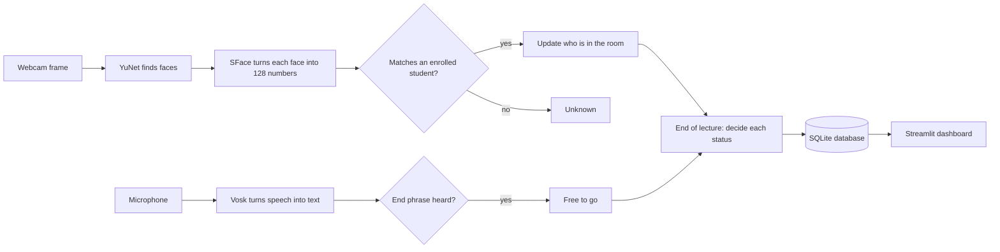

# face-attendance
# Face Attendance 📸

> A learning project: a webcam system that takes lecture attendance automatically by recognising faces, notices when people leave early, and listens for the lecturer saying "see you next week".

## Why I built this

At university, attendance is taken with a check-in app: you scan a QR code, type in a code or use Bluetooth during the lecture. That has two problems:

1. **Honest students get marked absent.** It's easy to forget to check in (especially at a 9 am lecture 😴), and then you're marked absent even though you sat through the whole thing.
2. **It's easy to cheat.** Someone can scan the code and walk out, or get the code from a friend without ever turning up.

What attendance really needs to answer is *"was this student actually in the lecture?"* This project answers that directly. A camera recognises enrolled students and keeps track of who is in the room. At the end it works out who was there for the whole lecture, who left in between, who came late and who didn't show up.

## What it does

- 🎥 **Recognises enrolled students** from a webcam in real time
- ⏱️ **Tracks presence over the whole lecture**, not just a single check-in
- 🚪 **Notices when someone leaves**: not seen for 7 minutes = "left"
- 🗣️ **Knows when the lecture is over.** After the 40-minute mark, or as soon as the lecturer says something like "see you next week", leaving no longer counts against anyone.
- 📋 **Saves every lecture** to a database: who was supposed to be there, who was there for the whole lecture, who left in between and who didn't show up
- 📊 **Dashboard** to browse lectures and see each student's attendance across a module

## How it works



1. **Enrolment.** Each student looks at the camera once. `enroll.py` takes 5 samples and turns each one into a *face embedding*: 128 numbers that describe the face, a bit like a fingerprint. Only these numbers are saved, never photos.
2. **Detection.** During a lecture, every webcam frame goes through **YuNet**, a small deep-learning face detector, which finds every face.
3. **Recognition.** Each face is straightened (using the eye, nose and mouth points) and turned into its own 128 numbers by **SFace**. It is compared with every enrolled student using *cosine similarity*, where 1.0 means identical and 0 means completely different. The best match above the threshold wins; otherwise the face is "Unknown".
4. **Tracking presence.** Every 30 seconds the system takes a "check" of who has been seen. Each person's percentage is the share of checks they were seen in.
5. **End of lecture.** It becomes **free to go** in the last 20 minutes, or as soon as the lecturer says an end phrase, and checks stop counting. A background thread runs **Vosk** offline speech recognition on the microphone to listen for phrases like "see you next week" or "that's it for today".
6. **Result.** Each student gets a status, and the lecture is saved to an SQLite database that the dashboard reads.

### Attendance rules

| Status | Meaning |
|---|---|
| ✅ Present | Seen in at least 80% of checks before "free to go" |
| 🚪 Left early | Below 80%, and last seen more than 7 minutes before "free to go" |
| ⏰ Partial | Below 80% but still there near the end (for example, came late) |
| ❌ Absent | Never seen, or only seen after "free to go" |
| ➕ Not on the class list | Recognised, but not expected at this module's lecture |

A 7-minute toilet break still leaves you at about 82%, so you're still **Present**.

### Design decisions

- **No motion tracker at the door.** A camera facing into the room usually sees the *back* of someone leaving, and people move quickly through doors. Instead, "left" simply means *not seen for 7 minutes*. That gives the same result and is far more reliable.
- **Confirm over 5 frames.** A name only counts after being recognised in 5 frames in a row, so one blurry frame can't create a false match.
- **Stricter threshold for attendance.** The recognition demo uses OpenCV's suggested threshold (0.363), while the attendance system uses 0.5 to reduce wrong matches. A clear face usually scores 0.9 or more.
- **No false "lecture over" early on.** End phrases heard in the first 30 minutes are ignored.
- **A small grammar for speech.** Vosk only listens for the end phrases, and everything else becomes "unknown". On a laptop microphone this is far more reliable than full transcription.

## Project structure

| File | What it does |
|---|---|
| `camera.py` | Step 1: shows the live webcam feed |
| `detect.py` | Step 2: finds faces with YuNet and draws boxes |
| `enroll.py` | Registers a person: saves 5 face embeddings to `data/<name>.npy` |
| `recognise.py` | Live demo: puts a name and similarity score on every face |
| `attendance.py` | The main system: runs a lecture and saves the result |
| `voice.py` | Listens to the microphone in the background for end phrases |
| `database.py` | SQLite storage and class lists |
| `dashboard.py` | Streamlit dashboard for browsing attendance |
| `mic_test.py` | Microphone volume meter for troubleshooting |

Not in the repo (they stay on the laptop, see `.gitignore`): `models/` (downloaded model files) and `data/` (face embeddings, class lists and the attendance database).

## Setup (Windows)

```
git clone https://github.com/MritunjayySinghh/face-attendance.git
cd face-attendance
py -m venv .venv
.venv\Scripts\activate
pip install -r requirements.txt
```

Download the two face models from the [OpenCV Zoo](https://github.com/opencv/opencv_zoo):

```
curl.exe -L --create-dirs -o models\face_detection_yunet_2026may.onnx https://media.githubusercontent.com/media/opencv/opencv_zoo/main/models/face_detection_yunet/face_detection_yunet_2026may.onnx
curl.exe -L -o models\face_recognition_sface_2021dec.onnx https://media.githubusercontent.com/media/opencv/opencv_zoo/main/models/face_recognition_sface/face_recognition_sface_2021dec.onnx
```

The Vosk speech model (~40 MB) downloads automatically the first time `voice.py` runs.

## Usage

1. **Enrol** each person. They press **S** five times, turning their head slightly between samples:
   ```
   python enroll.py
   ```
2. **Class lists.** Create `data/class_lists.csv` saying who should be at each module:
   ```
   module,name
   COMP1312,Mritunjay
   ```
3. **Run a lecture** and type the module code when asked:
   ```
   python attendance.py
   ```
   Keys: **E** = lecture over (same as the voice trigger), **Q** = stop now.
4. **See the results:**
   ```
   streamlit run dashboard.py
   ```

### Settings

The settings at the top of `attendance.py` are small, so a whole "lecture" can be tested in 3 minutes:

| Setting | Test value | Real lecture |
|---|---|---|
| `LECTURE_MINUTES` | 3 | 60 |
| `FREE_TO_GO_MINUTES` | 1 | 20 |
| `CHECK_EVERY_SECONDS` | 5 | 30 |
| `LEFT_AFTER_SECONDS` | 20 | 420 (7 min) |
| `EARLIEST_END_MINUTES` | 1 | 30 |
| `PRESENT_PERCENT` | 80 | 80 |

## Privacy and ethics

Face data used to identify people counts as **special category biometric data** under UK GDPR, so this project is built carefully:

- It is a **learning prototype**. It has only been tested at home, on my own face and on people who agreed to it. It has never been used in a real lecture.
- **No photos are stored**, only 128-number embeddings. They're kept locally in `data/`, which is git-ignored, so they never go to GitHub.
- **Audio is processed offline** by Vosk and is never recorded or saved.
- A real deployment would need the university's approval, explicit opt-in consent, a data protection impact assessment (DPIA), and a non-face way to check in for anyone who doesn't want to use it.

## Limitations

- A single laptop webcam only covers the first few rows. A lecture theatre would need proper cameras.
- **Photos can fool it.** Holding up a photo of someone on a phone gets them recognised. Liveness detection is on the roadmap.
- Accuracy drops with bad lighting, side-on faces and distance.
- The small Vosk model can mishear, which is why it only listens for a few phrases.
- The thresholds were tuned by hand on a small number of people.

## Roadmap

- [ ] Liveness detection, to stop photo and screen spoofing
- [ ] Start and end lectures automatically from the timetable
- [ ] Accuracy testing with more consenting volunteers (lighting, glasses, distance)
- [ ] Support for multiple cameras in large rooms
- [ ] Share the face-recognition code between scripts instead of repeating it

## Tech stack

Python 3.14 · OpenCV 5 (YuNet + SFace) · NumPy · Vosk · sounddevice · SQLite · Streamlit · pandas

## Credits

- [YuNet](https://github.com/opencv/opencv_zoo/tree/main/models/face_detection_yunet) face detector (MIT licence) and [SFace](https://github.com/opencv/opencv_zoo/tree/main/models/face_recognition_sface) face recogniser (Apache 2.0), both from the OpenCV Zoo
- [Vosk](https://alphacephei.com/vosk/) offline speech recognition (Apache 2.0)

Built by [Mritunjay](https://github.com/MritunjayySinghh) as a learning project.
